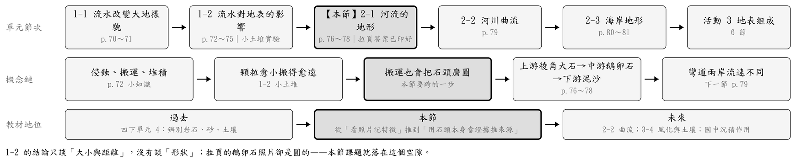

# 新北市〇〇國小教學方案設計〔待補：學校名稱〕

| | | | |
|---|---|---|---|
| **授課年級** | 六 年 〇 班〔待補：班級與人數〕 | **授課日期** | 〔待補：〇年〇月〇日（星期〇）第〇節〕 |
| **任教學科** | 自然科學領域 | **教學者（教案設計）** | 〔待補：姓名〕 |
| **單元名稱** | 第 3 單元〈變動的大地〉活動 2「水岸地貌」2-1 河流的地形（本節為活動 2 第 1 節〔依課本側欄推估，請校對〕） | **備課成員** | 〔待補：共備夥伴姓名，無則寫「無」〕 |
| **使用版本** | 南一（115 學年度上學期，六上）；課題型態：挑戰性課題 | | |

## 教學設計理念

課本 p.76～78 是一張拉頁：上游、中游、下游三張照片，每張旁邊都印好「常見景觀、地形特徵、流水作用」。上游河邊是大石頭，中游是鵝卵石，下游是泥沙——學生看圖就能把習作 p.29 的表填完，卻很少有人問：石頭為什麼會從有稜有角變成圓圓的？

學生在 1-2 做過小土堆，親眼看到「顆粒愈小，被搬得愈遠」。這條證據只說了大小，沒說形狀；而學生判斷石頭從哪裡來時，最常只看大小。真實的河更麻煩：上游的巨石搬不進教室，老師能撿回來的上游石頭，不一定比中游的鵝卵石大。

本節把拉頁收起來，每組拿到三袋標籤掉了的溪石，判斷各是上游、中游還是下游撿的，並寫出證據。大小與形狀兩條線索會打架，各組排法會不同；接著用寶特瓶搖粉筆的小實驗，讓學生親眼看到「被搬運的石頭會被磨圓、磨出細泥」。教師不裁決排法，只追證據；最後才打開拉頁，用學生自己的推論去讀那三張照片。

## 核心素養

| 總綱 | 領綱具體內涵 |
|---|---|
| A2 系統思考與解決問題（主） | 自然-E-A2 能運用好奇心及想像能力，從觀察、閱讀、思考所得的資訊或數據中，提出適合科學探究的問題或解釋資料，並能依據已知的科學知識、科學概念及探索科學的方法去想像可能發生的事情，以及理解科學事實會有不同的論點、證據或解釋方式。 |
| C2 人際關係與團隊合作（輔） | 自然-E-C2 透過探索科學的合作學習，培養與同儕溝通表達、團隊合作及和諧相處的能力。 |

## 領域課程綱要

| 學習表現 | 學習內容 | 學習目標 |
|---|---|---|
| tr-Ⅲ-1 能將自己及他人所觀察、記錄的自然現象與習得的知識互相連結，察覺彼此間的關係，並提出自己的想法及知道與他人的差異。 pa-Ⅲ-2 能從（所得的）資訊或數據，形成解釋、發現新知、獲知因果關係、解決問題或是發現新的問題。並能將自己的探究結果和他人的結果（例如：來自同學）比較對照，檢查相近探究是否有相近的結果。 | INd-Ⅲ-9 流水、風和波浪對砂石和土壤產生侵蝕、風化、搬運及堆積等作用，河流是改變地表最重要的力量。 | 1. 能依石頭的大小與形狀，判斷三袋溪石分別來自河流的上游、中游或下游，並至少用一筆前一節小土堆實驗的結果當證據。 2. 能從搖粉筆實驗說明「搬運會把石頭磨圓、磨出細泥」，並用它修正或補強自己的判斷。 |

## 教材組織與學生分析

**一、文本結構分析**

拉頁 p.76～78 把上中下游的「常見景觀、地形特徵、流水作用」全部印在照片旁（上游：V 字谷、大石頭；中游：曲流、鵝卵石；下游：泥沙淤積、三角洲），習作 p.29 只要對照照片填代號。p.78 教學小叮嚀也建議教師「結合前一節課的流水實驗結果」來說明。
1-2 的歸納（p.75）是「顆粒愈小的泥沙、石頭會被搬運、堆積到愈遠的位置」——只有大小，沒有形狀。拉頁中游照片的鵝卵石是圓的，課本沒有解釋為什麼。本節以實物溪石取代照片，任務中拉頁闔上。
限制攤開講：上游的巨石搬不進教室，上游袋只裝得下拳頭大小、帶稜角的石塊；因此大小不一定反映原地的大小，形狀成為關鍵證據。搖粉筆小實驗為課本未做的操作〔課前試做〕。

**二、學生可能面臨學習的困難及發現**

1. 只看大小不看形狀：上游袋的稜角石塊不比中游鵝卵石大，只看大小的組會把上游袋和中游袋排反；這會在導入的共有課題（每人記錄大小與形狀）那一刻現形。
2. 能背「下游石頭小」，說不出中間那一環「流速變慢，大的搬不動先停下來」；1-2 的實驗結果要被叫出來當證據，而不是當記憶。
3. 以為石頭是「本來就是圓的」或「被太陽晒圓的」：沒有「搬運的路上互相碰撞、磨掉稜角」的想像，需要搖粉筆實驗讓它看得見。
4. 把「磨圓」與「磨碎」分開：學生看到瓶底白泥時不一定想到「下游的細泥也可能是磨出來的」，這是本節不收斂的深究點。
5. 用非證據的理由判斷：「這袋比較乾淨所以是上游」「這袋比較重」——要回歸到大小、形狀與實驗結果。

**三、特殊學生特性描述**

〔待補：請教師提供學習停滯、超前、具潛力、幾乎不發言者的資訊，可指到組別或代號。補齊後觀課焦點將一併改為指名對象。〕

## 教學設計理據

| 類 | 項目 | 內容 |
|---|---|---|
| 教師 | 教學過程的構建 | 回想 1-2 小土堆結果 → 每人從三袋各摸一顆、記錄大小與形狀（共有課題）→ 布跳躍題：判斷三袋來自哪一段，寫兩筆證據 → 小組排序上牆 → 搖粉筆小實驗 → 修正排序 → 全班串連不同排法、追「磨出來的粉去哪裡」→ 打開拉頁對照 → 個人寫石頭的履歷。 |
| 教師 | 師生問題的生成 | 預想學生會問：「上游的石頭不是應該最大嗎？」「圓的石頭是被水磨圓的嗎？要多久？」「沙子是石頭變的嗎？」「為什麼不直接看照片？」「鵝卵石是哪一種岩石？」「下游的泥是從上游一路被沖下來的，還是路上磨出來的？」 |
| 教師 | 教學活動的開展 | 各自摸、比、記錄 → Pair 對照 → 四人組排序並寫兩筆證據上牆 → 小組搖粉筆實驗（四人輪流搖、計時、觀察、記錄）→ 小組修正排序 → 全班分享 → 個人寫「石頭的履歷」。 |
| 教師 | 教學語言的優化 | 拋題後閉嘴至少十秒，看誰先拿起石頭比大小、誰先摸稜角。全程不說「對」「錯」「很好」；學生說「這袋比較大」就追「還有別的線索嗎？」，說「圓圓的」就追「怎麼變圓的？」。站在黑板旁，同時看得到上牆的排序與各組的寶特瓶。 |
| 教材 | 教具的使用策略 | 每組三袋溪石（袋 1、2、3，各組號碼對應打亂，教師持對照表）：上游袋＝拳頭大小帶稜角石塊、中游袋＝雞蛋到拳頭大小的圓鵝卵石、下游袋＝細砂與小礫。故意讓上游袋不比中游袋大，使大小與形狀兩條線索打架。搖粉筆實驗：寶特瓶＋折斷的粉筆段＋小礫石＋水。 |
| 教材 | 教材的使用價值 | 1-2 的實驗結論（p.75）從「背過的句子」變成「推論的證據」；拉頁 p.76～78 從「作答來源」改成「最後對照的資料」；習作 p.29 留作回家，用今天的推論再填一次。 |
| 教材 | 教學目標的設計 | 目標 1 對應共有課題與排序（可從學習單紀錄表與上牆白板看見）；目標 2 對應搖粉筆實驗後的修正（可從學習單「原本以為／看到／現在認為」與全班發言看見）。兩條都限定在本節 40 分鐘內能被觀課者看到。 |
| 教材 | 學科作業的設計 | 學習單一人一份（見附件一）：①三袋石頭觀察紀錄（大小、形狀、摸起來）②我的判斷與證據 ③小組的排序與兩筆證據 ④搖粉筆實驗紀錄（搖前、搖 1 分鐘後）⑤原本以為／看到／現在認為 ⑥石頭的履歷：一顆鵝卵石從上游到中游經歷了什麼。各自寫，不由一人代筆。 |
| 學生 | 學生的心智水平 | 已會：流水有侵蝕、搬運、堆積三種作用；坡度陡流速快、顆粒小搬得遠（1-2 親手做過）；辨別岩石、砂、土壤（四下）。未會：形狀也是證據、搬運過程會磨圓與磨碎、用實物推回來源。〔待補：本班實際學情，請教師補充〕 |
| 學生 | 學習方式的選擇 | 先個人摸與記錄（每人都有第一手觀察）→ Pair 對照（少發言者先在兩人間開口）→ 四人組排序並寫證據（排序本身就是論證）→ 搖粉筆實驗四人輪流搖，每人都摸得到搖前與搖後的粉筆。 |
| 環境 | 教學情景的創設 | 四人小組〔待補：座位形式，請教師確認〕。三袋石頭倒在桌上的舊報紙上排成三堆；黑板畫一條從左（高）到右（低）的河，各組把袋號貼在自己判斷的位置，同一條河上看得到全班的排法。 |
| 環境 | 課程資源的開發 | 溪石由教師課前於溪邊或校園景觀石撿拾分裝〔待補：請確認來源，避免於保護區採集〕。搖粉筆實驗器材與搖動時間〔課前試做〕。加菜：提早完成的組比較「搖 1 分鐘」與「搖 2 分鐘」的粉筆。 |

## 各節次學習活動設計的重點（本次公開課為活動 2 第 1 節〔推估〕）

本單元共 12 節，活動 1「流水的作用」共 3 節，活動 2「水岸地貌」共 3 節；本節為活動 2 第 1 節〔依課本側欄推估，請校對〕。活動 1 已完成 1-1 流水改變大地樣貌（p.70～71）與 1-2 小土堆實驗（p.72～75），學生親眼看過陡坡侵蝕搬運較明顯、顆粒小的被搬得較遠〔請教師確認小土堆實驗是否已完成；若未完成，本節改以 1-2 教學影片 1'44 代替回想，導入多用 2 分鐘〕。因此本節不再教三種作用的定義，時間全放在用實物石頭推回來源、以及「搬運會磨圓」這一步。第 2 節接 p.79 河川曲流，本節結尾預告：同一個彎道，兩岸的水一樣快嗎？

## 本節學習活動設計（40 分鐘）

### 導入與發現（傾聽）｜9 分

**教學活動內容**

1. 回想小土堆（2 分）
看學習單上上一節的小土堆結果：「陡坡沖下來的是什麼？跑最遠的是什麼？」各自在心裡回答，不發表。

2.〔共有課題〕摸一摸、比一比（3 分）
每人從袋 1、2、3 各拿一顆石頭，摸一摸、比一比，在學習單①記錄每一顆的大小（比拳頭／雞蛋／米粒）、形狀（有稜角／圓圓的）。和旁邊的人對照。

3.〔跳躍題〕布題（4 分）
「老師從同一條溪的上游、中游、下游各撿了一袋石頭，標籤掉了。你們判斷每一袋是哪裡撿的，寫兩個證據，其中一個要用上一節小土堆看到的事。」說明限制：上游有的石頭比冰箱還大，搬不回來，老師只撿了裝得進袋子的。課本拉頁先不翻。

**教師支援、學習引導**

拋題後閉嘴，至少十秒不說話。
觀察各自記錄時誰只寫大小、誰也寫了形狀——只寫大小的學生後段串連先請他說。

【提示】「摸摸看邊邊。刺刺的還是滑滑的？」
【反問】（學生問「上游不是應該最大嗎？」）「你覺得呢？手上的石頭怎麼說？」
【釐清】（學生寫「比較大」）「再一次。比哪一袋大？」

觀察 Pair 對照時兩人排法不同的組，記下差在哪一袋——後段串連的材料。

### 探究與深化（串連）｜20 分

**教學活動內容**

4. 小組排序（8 分）
四人組討論，在小白板寫「袋＿是上游、袋＿是中游、袋＿是下游」，每一袋寫兩筆證據，其中一筆用 1-2 小土堆的結果；把袋號貼到黑板那條河上自己判斷的位置。

5. 搖粉筆小實驗（8 分）
寶特瓶裡放三段折斷的粉筆（有稜角）、一把小礫石和半瓶水，蓋緊。先摸一摸粉筆的斷口，再四人輪流搖，共搖 1 分鐘；倒出來摸粉筆、看瓶底的水。在學習單④記錄搖前、搖後。

6. 修正（4 分）
小組回到白板：要不要改排序？要不要換證據？各自在學習單⑤寫「我們原本以為＿＿，看到＿＿，現在我們認為＿＿」。改了的組在黑板的河上移動袋號，用不同顏色標記。

**教師支援、學習引導**

【安全】搖之前確認瓶蓋旋緊、瓶身擦乾；只上下搖，不甩、不對人；倒出粉筆與礫石時倒在報紙上，礫石不丟擲；操作後洗手。

巡走記下各組排法：「只看大小」「大小加形狀」「看到形狀但不確定」各幾組，黑板上同類放一起。
【轉問】（組內兩人僵持）「你們兩個看的線索差在哪裡？拿石頭給他看。」
【提示】（組內只比大小）「回到你的紀錄。形狀那一欄寫了什麼？」
【深究】（組看到粉筆變圓就停）「瓶底那些白白的水，是從哪裡來的？」

觀察哪一組搖完後移動了黑板上的袋號，記下他們是被哪一個現象說服——後段串連請他們說。

### 挑戰與聚斂（串連＋回歸）｜11 分

**教學活動內容**

7. 全班串連（8 分）
(a) 請三組說各自用的證據：只看大小的、看形狀的、用小土堆實驗的——證據並排，教師不裁決。
(b) 請一組移動過袋號的學生說「我被瓶子裡的哪一幕說服」，再轉給一開始就用形狀判斷的組。
(c) 追問：「粉筆磨掉的部分去哪裡了？下游的泥，有沒有可能是一路磨出來的？」小組 1 分鐘想，說出來。
(d) 打開拉頁 p.76～78：三張照片的石頭，和我們的三袋對得起來嗎？

8. 個人寫履歷（3 分）
各自在學習單⑥寫「一顆鵝卵石的履歷」：它在上游時長什麼樣、路上發生什麼、為什麼停在中游。預告下一節 p.79：同一個彎道，兩岸的水一樣快嗎？

**教師支援、學習引導**

串連進程 A（轉引・三種證據並排，見附錄）：生1（大小）→「還有沒有不一樣的證據？」→ 生2（形狀）→「多了一種。還有嗎？」→ 生3（小土堆）→ 收束：「三種證據——哪一種會跟大小打架？」

串連進程 B（轉問・被說服的那一幕，見附錄）：生1（原把上中游排反）→「〇〇組，你們一開始就排對，當時看的是什麼？」→ 生2 →「生3，這兩組看的線索差在哪裡？」→ 生3 講不清 →【釐清】「再一次。」→【回歸】「回到粉筆。搖完以後摸起來怎樣？」

串連進程 C（深究・磨掉的去哪裡，見附錄）：生1「粉筆變圓了」→「磨掉的那一塊呢？」→ 生2「變成白白的水」→「那下游的泥呢？」→ 生3 →「石頭搖一分鐘磨這麼一點，河裡的石頭要多久？」

【回歸】「回到拉頁。中游的鵝卵石長什麼樣？」
不宣布正確答案；學生把「被水搬的路上磨圓了」說出口後，只回「這是你們搖出來的」。

> 彈性條款：本跳躍題（步驟 5 的搖粉筆實驗與步驟 7(c) 的追問）將依教學實際進度調整。若步驟 4 小組排序超過 10 分鐘，搖粉筆改由教師在講桌以實物投影示範一瓶，各組只做觀察與修正，串連照跑；若前一節未完成 1-2 小土堆實驗，本節只做到步驟 4，搖粉筆與串連移至下一節。器材：粉筆與小礫石的份量、搖動 1 分鐘能否明顯磨圓皆為推估值，課本未做過此操作，課前須試做一次；溪石的分裝須確認上游袋不比中游袋大。安全：瓶蓋旋緊、只上下搖不甩動；礫石不丟擲、不入口；操作後洗手；溪石採集勿於保護區或私人土地。

## 附錄：理答預想與串連進程表

### 單步預想

| 策略 | 預想的學生回應 | 判讀 | 教師理答 |
|---|---|---|---|
| 轉引 | （只講結論）「袋 2 是上游。」 | 有判斷沒證據，先要證據再轉給下一組。 | 「你看到什麼？」 |
| 轉問 | （沉默）被點名後低頭摸石頭不出聲。 | 可能還沒把觸覺整理成句子，把求救權交給他。 | 「你需要想一下是嗎？那你可以先找人幫忙嗎？」 |
| 反問 | 「老師，你直接給我們看照片就好了啊？」 | 要答案來源；把問題退回給他想石頭能說什麼。 | 「如果沒有照片，只有石頭，你能知道嗎？」 |
| 提示 | （講錯）「袋 3 最大顆，所以是上游。」 | 只看大小；不說錯，給最小線索讓他自己看形狀。 | 「回到你的手。摸摸看邊邊。」 |
| 釐清 | （含混）「這袋就是……比較像河邊的。」 | 「像」沒有說根據，不代答。 | 「再一次。像在哪裡？」 |
| 深究 | （答對但停在表層）「下游是沙子，因為小的跑最遠。」 | 結論正確，只有一筆證據；要第二筆。 | 「還有沒有第二個證據？」 |
| 回歸 | （離題）「我家魚缸的石頭也是圓的，是不是也是河裡撿的？」 | 生活連結，但會把討論帶到人工加工；拉回三袋。 | 「好問題，先記著。回到袋 1、2、3。」 |
| 回歸 | （離題）「這顆石頭裡面有亮亮的，是不是寶石？」 | 礦物是活動 3 的事，不展開，留一句給他。 | 「活動 3 會用到。現在看它的形狀。」 |

### 串連進程

理答不是一問一答，是把三個人的發言串成一條線。下表預想每一段串連的三步：學生說了什麼、教師接哪一句、這一步把誰的思考跟誰串在一起。學生以生1／生2／生3 代稱；〔待補特殊學生後，B 段第二步預定指名平時少發言的學生〕。

**轉引**｜第 7(a) 步・三種證據並排（挑戰與聚斂，第 29～32 分鐘）

目標：三種證據到齊，教師不評價；收束句把「誰排對」變成「哪一種證據會跟大小打架」。

| 步 | 學生發言 | 教師理答 | 這一步在串什麼 |
|---|---|---|---|
| 1. 生1（大小派） | 「上游的水最急，可以搬最大的，所以最大的那袋是上游。」 | 【轉引】「還有沒有不一樣的證據？」 | 不評價，把發言權交出去；生1 的推理有道理，留在黑板上。 |
| 2. 生2（形狀派） | 「我們看的是邊邊，刺刺的那袋是上游，因為還沒被磨。」 | 【轉引】「多了一種。還有嗎？」 | 生2 的「形狀」疊在生1 的「大小」旁邊，兩種線索並排出現。 |
| 3. 生3（實驗派） | 「上一節小土堆，細的跑最遠，所以沙子那袋是下游。」 | 【轉引・收束】「三種證據都在黑板上。哪一種會跟大小打架？」 | 三種到齊才拋問題；讓學生自己發現上游袋與中游袋的大小差不多，形狀才分得開。 |

**轉問**｜第 7(b) 步・被說服的那一幕（挑戰與聚斂，第 32～34 分鐘）

目標：甲（原把上中游排反）→ 立場不同的乙（一開始就用形狀）→ 丙說出兩組線索的差別；教師不裁決，最後【回歸】搖過的粉筆。

| 步 | 學生發言 | 教師理答 | 這一步在串什麼 |
|---|---|---|---|
| 1. 生1（原排反） | 「我們本來說大顆的圓石頭是上游……可是粉筆搖完變圓了。」 | 【轉問】「〇〇組，你們一開始就排對，當時看的是什麼？」 | 不回饋，轉給一開始就用形狀的組，讓生1 聽到另一種看法。 |
| 2. 生2（形狀派） | 「我們覺得圓的一定是走很久了，走很久就是離上游很遠。」 | 【轉問】「生3，這兩組看的線索差在哪裡？」 | 不說誰對，找第三位（預定指平時少發言者）把「大小」和「走了多久」並排講出來。 |
| 3. 生3 | 「一個是看……多大，一個是看……有沒有被磨……」（斷斷續續） | 【釐清】「再一次。」→【轉問】「有人要幫他補一下嗎？」→【回歸】「回到粉筆。搖之前和搖之後，邊邊怎樣？」 | 修正的動作留在學生身上，由粉筆裁決，教師不宣布答案。 |

**深究**｜第 7(c) 步・磨掉的去哪裡（挑戰與聚斂，第 34～37 分鐘）

目標：一個現象 → 現象的另一半 → 接回下游 → 推到「河裡要多久」這個本節不收斂的問題。

| 步 | 學生發言 | 教師理答 | 這一步在串什麼 |
|---|---|---|---|
| 1. 生1 | 「粉筆的角不見了，變圓了。」 | 【深究】「角不見了，那一塊去哪裡了？」 | 只看到磨圓；追被磨掉的那一半。 |
| 2. 生2 | 「變成瓶子底下白白的水，很細的粉。」 | 【深究】「那下游袋裡的細沙和泥呢？」 | 把瓶底細粉和下游袋接在一起；追的是來源，不是對錯。 |
| 3. 生3 | 「可能有一些是上面的石頭一路撞、一路磨出來的？」 | 【深究】「粉筆搖一分鐘才磨這麼一點。河裡的石頭，要多久？」→ 接第 8 步個人寫履歷 | 不宣布答對；用他的推論撞向「時間尺度」，留給學生寫進履歷。 |

---

# 公開授課觀課紀錄表

| | |
|---|---|
| 授課老師 | 〔待補：姓名〕 |
| 觀課班級 | 六 年 〇 班〔待補〕 |
| 觀課日期 | 〔待補：〇年〇月〇日〕 |
| 科目單元 | 自然科學　第 3 單元〈變動的大地〉活動 2 河流的地形 |
| 觀課教師／學校 | |
| 觀課教師／姓名 | |

## 本課觀課焦點

〔待補特殊學生後，請改為指名觀察對象〕
1. 就近看 1～2 位學生：導入第 2 步記錄時，他只寫大小，還是也寫了形狀？到第 8 步寫履歷時，有沒有用到「磨圓」？是在哪一刻開始用的——Pair 對照時、上牆時、還是搖完粉筆後？
2. 就近看一組：第 5 步倒出粉筆時，組內第一句話是誰說的、說了什麼？有沒有人把粉筆和桌上的石頭拿在一起比？
3. 第 7(c) 步教師追問「磨掉的去哪裡」時，就近那一組有沒有人把瓶底的白水和下游袋連起來？平時少發言的人有沒有在這一分鐘開口？

## 觀課紀錄

（三向度與 8 個引導問句依制式表原樣，見 docx。）

---

## 附件一：學習單「石頭的履歷」

一人一份。第①②題在導入段完成，第③題小組排序時完成，第④⑤題搖粉筆後完成，第⑥題最後三分鐘完成。小組討論時各自寫，不由一人代筆。課本拉頁 p.76～78 在第 7(d) 步才打開。

上一節小土堆實驗：陡坡沖下來的是＿＿＿＿＿；被搬得最遠的是＿＿＿＿＿。

① 從每一袋拿一顆，摸一摸、比一比，記錄下來。

**① 三袋石頭觀察紀錄**

|  | 袋 1 | 袋 2 | 袋 3 |
|---|---|---|---|
| 大小（像拳頭／雞蛋／米粒） |  |  |  |
| 形狀（有稜角／圓圓的） |  |  |  |
| 摸起來 |  |  |  |

**②③ 判斷與證據**

|  |  |
|---|---|
| ② 我的判斷 | 上游：袋＿　中游：袋＿　下游：袋＿ 證據：  |
| ③ 我們這組 | 上游：袋＿　中游：袋＿　下游：袋＿ 證據一： 證據二（用小土堆實驗）：  |

**④ 搖粉筆實驗紀錄**

|  | 搖之前 | 搖 1 分鐘之後 |
|---|---|---|
| 粉筆的邊邊 |  |  |
| 瓶子裡的水 |  |  |

**⑤⑥ 對照與履歷**

|  |  |
|---|---|
| ⑤ 我們原本以為 |    |
| 　看到 |    |
| 　現在我們認為 |    |
| ⑥ 一顆鵝卵石的履歷：它在上游時長什麼樣？路上發生什麼？為什麼停在中游？ |     |

---

## 附件二：器材與安全清單（每組）

安全規則（搖之前全班確認）：瓶蓋旋緊、瓶身擦乾；只上下搖，不甩、不對人；粉筆與礫石倒在報紙上，礫石不丟擲、不入口；操作後洗手。

| 器材 | 數量 | 用途 |
|---|---|---|
| 溪石三袋（袋 1、2、3） | 各 1 | 上游＝拳頭大小帶稜角；中游＝圓鵝卵石；下游＝細砂小礫。各組袋號對應打亂，教師持對照表 |
| 寶特瓶（600 mL，附蓋） | 1 | 搖粉筆實驗 |
| 粉筆（折成 3 段） | 1 支 | 模擬帶稜角的石塊 |
| 小礫石 | 1 把 | 模擬一起被搬運的砂石 |
| 水 | 半瓶 | 模擬流水 |
| 舊報紙 | 2 張 | 倒出石頭與粉筆 |
| 小白板＋白板筆、袋號磁貼 | 各 1 | 排序與證據上牆；袋號貼到黑板的河上 |
