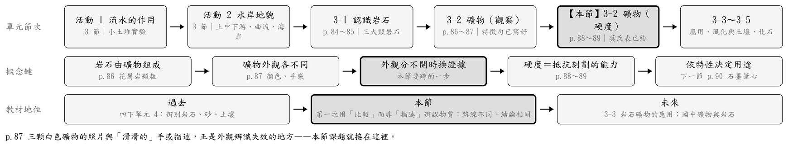

# 新北市〇〇國小教學方案設計〔待補：學校名稱〕

| | | | |
|---|---|---|---|
| **授課年級** | 六 年 〇 班〔待補：班級與人數〕 | **授課日期** | 〔待補：〇年〇月〇日（星期〇）第〇節〕 |
| **任教學科** | 自然科學領域 | **教學者（教案設計）** | 〔待補：姓名〕 |
| **單元名稱** | 第 3 單元〈變動的大地〉活動 3「地表組成」3-2 礦物——礦物的硬度（本節為活動 3 第 3 節〔依課本側欄推估，請校對〕） | **備課成員** | 〔待補：共備夥伴姓名，無則寫「無」〕 |
| **使用版本** | 南一（115 學年度上學期，六上）；課題型態：挑戰性課題 | | |

## 教學設計理念

課本 p.87 把七種礦物排在同一頁，旁邊寫好每一種的顏色與手感；p.88 再把莫氏硬度表和「互相刻劃」的方法一起印出來。學生翻到這兩頁，答案已經在紙上——照做一次，就會得到「硬度大的可以刻劃硬度小的」這句歸納。

可是 p.87 的照片裡，滑石、方解石、石英三顆都是白色，課本還寫方解石和滑石「摸起來都滑滑的」。上一節學生用眼睛和手觀察，其實分不開這三顆；他們缺的不是硬度的定義，而是「外觀靠不住時，要換哪一種證據」的經驗。

本節把三顆白色礦物的標籤拿掉，只給指甲、鐵釘和礦物本身，請小組找出誰是誰、排出硬度順序，並挑戰用最少的刻劃次數完成。開胃菜是人人刮得出痕的滑石，主菜是分開方解石與石英，加菜是「最少幾次一定夠」。教師不預告答案，也不在操作中說誰對；各組不同的刻劃路線上牆並排，讓學生自己發現「路線不同、順序相同」，再回到 p.88 的莫氏表對照。

## 核心素養

| 總綱 | 領綱具體內涵 |
|---|---|
| A2 系統思考與解決問題（主） | 自然-E-A2 能運用好奇心及想像能力，從觀察、閱讀、思考所得的資訊或數據中，提出適合科學探究的問題或解釋資料，並能依據已知的科學知識、科學概念及探索科學的方法去想像可能發生的事情，以及理解科學事實會有不同的論點、證據或解釋方式。 |
| C2 人際關係與團隊合作（輔） | 自然-E-C2 透過探索科學的合作學習，培養與同儕溝通表達、團隊合作及和諧相處的能力。 |

## 領域課程綱要

| 學習表現 | 學習內容 | 學習目標 |
|---|---|---|
| pe-Ⅲ-2 能正確安全操作適合學習階段的物品、器材儀器、科技設備及資源。能進行客觀的質性觀察或數值量測並詳實記錄。 pa-Ⅲ-2 能從（所得的）資訊或數據，形成解釋、發現新知、獲知因果關係、解決問題或是發現新的問題。並能將自己的探究結果和他人的結果（例如：來自同學）比較對照，檢查相近探究是否有相近的結果。 | INc-Ⅲ-11 岩石由礦物組成，岩石和礦物有不同特徵，各有不同用途。 | 1. 能用指甲、鐵釘與礦物互刻，正確判讀「誰被刻出凹痕」，辨認出滑石、方解石、石英，並排出三者的硬度順序。 2. 能比較各組不同的刻劃路線，說出為什麼路線不同卻得到相同順序，並說明自己這組的路線是否還能更省次數。 |

## 教材組織與學生分析

**一、文本結構分析**

課本 3-2 分兩節：p.86～87 觀察礦物外觀（上一節），p.88～89 硬度（本節）。p.88 已印好提問、假設、莫氏硬度表與「任選兩種互相刻劃」的方法，p.89 的歸納句也寫好；習作 p.33 的結果表固定為壹圓硬幣、石英、滑石。
本節不重做「照方法刻一次」，而是把 p.87 留下的困惑（三顆白色分不開）當成任務：只用刻劃找出誰是誰。工具換成指甲（約 2.5）與鐵釘（約 5.5），避開與方解石（3）硬度接近、結果易兩可的硬幣〔推估值，課前試做〕。
莫氏表在任務中闔上，聚斂段才打開對照——讓表成為驗證的依據，而不是作答的來源。

**二、學生可能面臨學習的困難及發現**

1. 「誰刻誰」讀反：看到粉末就說「掉粉的那顆比較硬」。其實有凹痕、掉粉的是被刻的、較軟的那顆；習作 p.33 第 1 題就在考這一點。
2. 把工具留下的痕跡當成刻痕：鐵釘在石英上會留下灰黑色的金屬痕，方解石在石英上會留下白粉，看起來都像「被刻了」。要用濕紙巾擦過、用放大鏡看「是凹下去還是蓋上去」。
3. 力道不足造成誤判：鐵釘輕輕劃方解石沒有痕，學生會判斷「方解石比鐵釘硬」，進而把方解石和石英弄反。
4. 「最少次數」需要先推理再動手；多數組會把三顆兩兩全刻一遍（3 次以上），只有部分組會想到「先用指甲找出最軟的，剩下兩顆刻一次就好」。
5. 把「滑滑的」當硬度證據：上一節的手感描述會被拿來當理由，「滑石摸起來最滑所以最軟」——結論碰巧對，理由不是硬度。

**三、特殊學生特性描述**

〔待補：請教師提供學習停滯、超前、具潛力、幾乎不發言者的資訊，可指到組別或代號。補齊後觀課焦點將一併改為指名對象。〕

## 教學設計理據

| 類 | 項目 | 內容 |
|---|---|---|
| 教師 | 教學過程的構建 | 回想上一節「三顆白色分不開」→ 每人用指甲各刮一次（共有課題）→ 布跳躍題：找出誰是誰、排順序、挑戰最少次數 → 小組先畫刻劃路線再操作 → 擦痕判讀、記錄 → 路線上牆 → 全班串連不同路線、追「最少幾次一定夠」→ 打開 p.88 莫氏表對照 → 個人寫結論。 |
| 教師 | 師生問題的生成 | 預想學生會問：「有粉末的是哪一顆的粉？」「鐵釘劃不出來，是不是我太小力？」「可以用牙齒咬嗎？」「為什麼不能用硬幣？」「方解石跟滑石都滑滑的，滑是不是就是軟？」「兩次就夠了嗎？要是運氣不好呢？」 |
| 教師 | 教學活動的開展 | 個人用指甲刮三顆 → Pair 對照誰刮出痕 → 四人組畫「刻劃路線圖」→ 分工操作（刻劃者、擦拭者、放大鏡觀察者、記錄者，每次輪替）→ 小組寫順序與次數 → 路線上牆 → 全班串連 → 個人寫結論。 |
| 教師 | 教學語言的優化 | 拋題後閉嘴至少十秒，看誰先伸指甲。全程不說「對」「錯」「很好」；學生說「這顆比較硬」就追「你看到什麼？」，說「有痕」就追「擦過了嗎？」。站在教室中段，同時看得到黑板上的路線圖與各組的放大鏡。 |
| 教材 | 教具的使用策略 | 每組三顆白色礦物，貼 A／B／C 貼紙，各組字母對應打亂（教師持對照表），避免組間對答案。鐵釘一支、放大鏡一個、濕紙巾、黑色墊紙（讓白粉看得見）。學習單附刻劃結果矩陣（仿習作 p.33 的格式）。 |
| 教材 | 教材的使用價值 | p.87 的三顆白色照片與「滑滑的」描述當導入的困惑；p.88 的莫氏硬度表從「作答來源」改成「驗證依據」，聚斂段才打開；習作 p.33 的矩陣格式沿用，回家再做一次硬幣版，對照今天為什麼不用硬幣。 |
| 教材 | 教學目標的設計 | 目標 1 對應操作與辨認（可從學習單矩陣與小組白板看見）；目標 2 對應路線比較與「還能不能更省」（可從全班串連發言與學習單最後一欄看見）。兩條都限定在本節 40 分鐘內能被觀課者看到。 |
| 教材 | 學科作業的設計 | 學習單一人一份（見附件一）：①指甲刮痕紀錄 ②我們的刻劃路線（先畫後做）③刻劃結果矩陣 ④我們的答案：A／B／C 各是誰、硬度順序、用了幾次 ⑤別組的路線和我們哪裡不同 ⑥我的結論。小組操作時各自記錄，不由一人代筆。 |
| 學生 | 學生的心智水平 | 已會：岩石由礦物組成、礦物有顏色與手感等特徵（上一節）、上學期做過變因與比較實驗。未會：外觀不可靠時要換證據、「被刻出凹痕的較軟」的方向判讀、用推理減少操作次數。〔待補：本班實際學情，請教師補充〕 |
| 學生 | 學習方式的選擇 | 先個人刮（每人都有第一手證據）→ Pair 對照（少發言者先在兩人間開口）→ 四人組先畫路線再動手（讓推理先於操作，路線圖本身就是可比較的思考）→ 分工輪替，每人都至少刻一次、擦一次、看一次。 |
| 環境 | 教學情景的創設 | 四人小組〔待補：座位形式，請教師確認〕。每組桌面鋪黑色墊紙，礦物放在墊紙上刻劃；鐵釘不用時插在橡皮擦上。黑板預留「路線牆」，每組一格。 |
| 環境 | 課程資源的開發 | 學校礦物組的滑石、方解石、石英〔待補：請確認數量足夠每組一套〕；不足時以石膏替代滑石（硬度 2，指甲可刻）並修改附件。加菜題：教師另備一顆螢石（硬度 4）供提早完成的組判斷位置。 |

## 各節次學習活動設計的重點（本次公開課為活動 3 第 3 節〔推估〕）

本單元共 12 節，活動 3「地表組成」共 6 節；本節為活動 3 第 3 節〔依課本 p.88 側欄推估，請校對〕。第 1 節認識岩石三大類（p.84～85），第 2 節觀察礦物外觀（p.86～87），學生已用顏色、光澤、手感描述過七種礦物，並已發現「有的很像」〔請教師確認上一節是否已完成 p.87 觀察；若未完成，導入多用 3 分鐘讓學生先看三顆的外觀〕。因此本節不再教「礦物是什麼」，時間全放在用刻劃辨認與排序。第 4 節接 p.90～91 岩石礦物的應用，本節結尾預告「石墨為什麼能做筆心」。

## 本節學習活動設計（40 分鐘）

### 導入與發現（傾聽）｜9 分

**教學活動內容**

1. 回想上一節（1 分）
各組桌上放三顆貼 A／B／C 的白色礦物。教師：「上一節我們看過，這三顆是滑石、方解石、石英，可是標籤掉了。」各自看一看、摸一摸。

2.〔共有課題〕指甲刮刮看（4 分）
每人用指甲在 A、B、C 上各用力刮一次，擦一擦，在學習單①記錄「有凹痕／沒有」。和旁邊的人對照結果。

3.〔跳躍題〕布題（4 分）
「只能用指甲、鐵釘、礦物彼此互刻，找出 A、B、C 各是誰，排出硬度順序。挑戰：用最少的刻劃次數完成。」說明限制：課本習作用的是壹圓硬幣，今天換成鐵釘；為什麼換，最後再說。莫氏硬度表先不翻。

**教師支援、學習引導**

拋題後閉嘴，至少十秒不說話。
觀察誰刮完會去擦、誰直接看粉——直接看粉的學生後段先請他說。

【反問】（學生問「滑滑的是不是比較軟」）「你覺得呢？刮刮看。」
【釐清】（學生說「B 有痕」）「再一次。擦過了嗎？凹下去還是蓋上去？」
【提示】（不敢用力）「用力一點，像要在上面寫字。」

觀察 Pair 對照時兩人結果不同的組，記下是哪一顆——後段串連的材料。

### 探究與深化（串連）｜20 分

**教學活動內容**

4. 先畫路線（5 分）
四人組在學習單②畫「刻劃路線圖」：先刻哪兩顆、用什麼刻、預期會怎樣、下一步看結果決定刻什麼。路線畫好才拿鐵釘。

5. 操作與記錄（12 分）
照路線刻劃。每刻一次：刻劃者刻、擦拭者用濕紙巾擦、觀察者用放大鏡看「凹痕還是粉蓋上去」、記錄者填學習單③矩陣；每次輪替角色。記下實際用了幾次。

6. 寫答案（3 分）
小組在小白板寫「A＝＿、B＝＿、C＝＿；硬度由小到大：＿＜＿＜＿；用了＿次」，貼上黑板路線牆。

**教師支援、學習引導**

【安全】操作前全班複誦：鐵釘只往身體外側劃、不用時插在橡皮擦上；刻劃時礦物放在墊紙上、不拿在手上對著自己；石英碎屑不要用手抹、用濕紙巾擦；礦物不放進嘴裡。

巡走記下各組路線：「全部兩兩刻」「先指甲再鐵釘」「先指甲再互刻一次」各幾組，上牆時把同類放一起。
【轉問】（組內對同一道痕判讀不同）「你們兩個看到的差在哪裡？用放大鏡給他看。」
【提示】（鐵釘劃方解石沒痕就下結論）「回到你的力道。跟剛剛指甲一樣用力嗎？」
【深究】（組已排好順序就停手）「你們用了幾次？少一次可以嗎？」

觀察哪一組把方解石、石英弄反，記下他們是哪一步判讀成「沒痕」——後段串連請他們說「是哪一刀讓我們改的」。

### 挑戰與聚斂（串連＋回歸）｜11 分

**教學活動內容**

7. 全班串連（8 分）
(a) 請三組依序說自己的路線：全部兩兩刻／先指甲再鐵釘／先指甲再互刻一次——路線並排，教師不評價。
(b) 請一組判讀曾經改過的組說「是哪一道痕讓我們改的」，再轉給判讀相反的組。
(c) 追問：「最少幾次一定夠？兩次永遠夠嗎？運氣不好的時候呢？」小組 1 分鐘想，說出來。
(d) 打開 p.88 莫氏硬度表：滑石 1、方解石 3、石英 7——各組的順序和表一樣嗎？鐵釘、指甲大概在表上哪裡？

8. 個人結論（3 分）
各自在學習單⑥寫結論，並回答「為什麼今天不用壹圓硬幣」（提示：查 p.88 表上 3 附近）。預告下一節 p.90：石墨那麼軟，為什麼適合做筆心？

**教師支援、學習引導**

串連進程 A（轉引・三種路線並排，見附錄）：生1（兩兩全刻）→「還有沒有不一樣的走法？」→ 生2（指甲先找滑石）→「多了一種。還有嗎？」→ 生3（指甲＋互刻一次）→ 收束：「三種路線，答案一樣——為什麼走法不同，順序卻一樣？」

串連進程 B（轉問・粉是誰的，見附錄）：生1「石英掉粉，所以石英比較軟」→「〇〇組，你們看到的粉在哪一顆上？」→ 生2 →「生3，這兩組說的粉，差在哪裡？」→ 生3 講不清 →【釐清】「再一次。」→【回歸】「回到放大鏡。凹下去還是蓋上去？」

串連進程 C（深究・最少次數，見附錄）：生1「兩次就夠」→「每一次都夠嗎？」→ 生2「要看第一次刻到哪兩顆」→「什麼情況兩次不夠？」→ 生3 →「那如果有四顆呢？」

【回歸】「回到 p.88 的表。滑石在哪一格？」
不宣布正確答案；學生把「被刻出凹痕的比較軟」說出口後，只回「這是你們刻出來的」。

> 彈性條款：本跳躍題（步驟 5 的完整操作與步驟 7(c) 最少次數的追問）將依教學實際進度調整。若步驟 4 畫路線超過 7 分鐘，改為教師在實物投影下示範一次「鐵釘刻方解石」的判讀，各組只完成辨認與排序，(c) 移至下一節開頭；若前一節未完成 p.87 礦物外觀觀察，本節只做到步驟 5，串連移至下一節。器材：指甲、鐵釘對方解石的刻劃結果與力道為推估值，課前須以實際教具試做一次（特別確認鐵釘能在方解石上留下可見凹痕、不能在石英上留下凹痕）。安全：鐵釘尖端朝外、不用時插在橡皮擦上；石英碎屑以濕紙巾擦除，不以手抹；礦物不入口；操作結束收回鐵釘並清點。

## 附錄：理答預想與串連進程表

### 單步預想

| 策略 | 預想的學生回應 | 判讀 | 教師理答 |
|---|---|---|---|
| 轉引 | （只講結論）「A 是石英。」 | 有答案沒證據，先要證據再轉給下一組。 | 「你刻了什麼？」 |
| 轉問 | （沉默）被點名後看著礦物不出聲。 | 可能還沒把結果組織成句子，把求救權交給他。 | 「你需要想一下是嗎？那你可以先找人幫忙嗎？」 |
| 反問 | 「老師，到底哪一顆是石英？」 | 要標準答案，把裁決權交回刻痕。 | 「鐵釘會告訴你。」 |
| 反問 | 「可以用牙齒咬看看嗎？」 | 想換工具，是好的直覺；但不安全，退回到為什麼要換。 | 「你想用牙齒，是想知道什麼？手上的工具做得到嗎？」 |
| 提示 | （講錯）「C 有一堆白粉，所以 C 比較硬。」 | 「誰刻誰」讀反；不說錯，給最小線索讓他自己翻。 | 「回到放大鏡。粉是從哪一顆掉下來的？」 |
| 釐清 | （含混）「就……這顆刻那顆，然後那顆……有。」 | 主詞不清，不代答。 | 「再一次。誰拿來刻？誰被刻？」 |
| 深究 | （答對但停在表層）「滑石最軟，因為指甲刮得動。」 | 只有一筆證據；要求第二筆。 | 「還有沒有第二個方法也能證明它最軟？」 |
| 回歸 | （離題）「我阿嬤的玉手鐲也很硬，是不是石英？」 | 生活連結但不在本節任務；留一句給下一節應用。 | 「下一節會用到。現在回到 A、B、C。」 |

### 串連進程

理答不是一問一答，是把三個人的發言串成一條線。下表預想每一段串連的三步：學生說了什麼、教師接哪一句、這一步把誰的思考跟誰串在一起。學生以生1／生2／生3 代稱；〔待補特殊學生後，B 段第二步預定指名平時少發言的學生〕。

**轉引**｜第 7(a) 步・三種路線並排（挑戰與聚斂，第 29～32 分鐘）

目標：三種刻劃路線到齊，教師不評價；收束句把「答案一樣」變成「為什麼路線不同、順序相同」。

| 步 | 學生發言 | 教師理答 | 這一步在串什麼 |
|---|---|---|---|
| 1. 生1（兩兩全刻組） | 「我們 A 刻 B、B 刻 C、A 刻 C 全部都刻，就知道了。」 | 【轉引】「還有沒有不一樣的走法？」 | 不評價，把發言權交出去；生1 的「全部刻」是最穩的路線，留在黑板上當基準。 |
| 2. 生2（指甲先行組） | 「我們先用指甲，刮得動的就是最軟的，剩下兩顆再用鐵釘。」 | 【轉引】「多了一種。還有嗎？」 | 生2 加入「先排除」的想法，和生1 並排出現次數的差別。 |
| 3. 生3（指甲＋互刻組） | 「剩下兩顆不用鐵釘，直接互刻一次就好。」 | 【轉引・收束】「三種走法都在黑板上，答案都一樣——為什麼走法不同，順序卻一樣？」 | 三種路線到齊才拋問題；把「硬度是礦物本身的性質、和怎麼測無關」交給學生說。 |

**轉問**｜第 7(b) 步・粉是誰的（挑戰與聚斂，第 32～34 分鐘）

目標：甲（讀反：掉粉＝硬）→ 立場不同的乙（凹痕＝軟）→ 丙說出兩組判讀的差別；教師不裁決，最後【回歸】放大鏡。

| 步 | 學生發言 | 教師理答 | 這一步在串什麼 |
|---|---|---|---|
| 1. 生1（原本讀反的組） | 「方解石刻石英的時候石英上面有白白的，所以我們本來以為石英比較軟。」 | 【轉問】「〇〇組，你們看到的白白的在哪一顆上？」 | 不回饋，轉給判讀相反的組，讓生1 聽到另一種讀法。 |
| 2. 生2（判讀正確的組） | 「那個白白的一擦就掉了，石英上面沒有凹下去；方解石上面才有一條溝。」 | 【轉問】「生3，這兩組說的白白的，差在哪裡？」 | 不說誰對，找第三位（預定指平時少發言者）把「蓋上去」與「凹下去」並排講出來。 |
| 3. 生3 | 「一個是……粉黏上去，一個是……真的刮掉……」（斷斷續續） | 【釐清】「再一次。」→【轉問】「有人要幫他補一下嗎？」→【回歸】「回到放大鏡。擦過以後，凹下去的是哪一顆？」 | 修正的動作留在學生身上，由放大鏡下的刻痕裁決，教師不宣布答案。 |

**深究**｜第 7(c) 步・最少次數（挑戰與聚斂，第 34～37 分鐘）

目標：一個答案 → 追條件 → 追反例 → 推到「四顆時要幾次」這個本節不收斂的問題。

| 步 | 學生發言 | 教師理答 | 這一步在串什麼 |
|---|---|---|---|
| 1. 生1 | 「兩次就夠了，指甲一次、互刻一次。」 | 【深究】「指甲那一次，要刮幾顆？」 | 不確認，先追「一次」到底包含什麼；讓全班發現指甲其實要試到找出滑石為止。 |
| 2. 生2 | 「如果第一顆就刮得動就一次，運氣不好要刮兩顆。」 | 【深究】「那最壞的情況，總共要幾次？」 | 追的是「一定夠」的條件，不是「有沒有可能」；把生1 的最好情況和生2 的運氣放在一起。 |
| 3. 生3 | 「最壞是三次……可是只互刻的話，兩次刻對了也可以……要看先刻哪兩顆。」 | 【深究】「那如果桌上有四顆呢？」→ 接第 8 步個人結論 | 不宣布答對；用他的「要看先刻哪兩顆」去撞更大的問題，留給有餘力者。 |

---

# 公開授課觀課紀錄表

| | |
|---|---|
| 授課老師 | 〔待補：姓名〕 |
| 觀課班級 | 六 年 〇 班〔待補〕 |
| 觀課日期 | 〔待補：〇年〇月〇日〕 |
| 科目單元 | 自然科學　第 3 單元〈變動的大地〉活動 3 礦物的硬度 |
| 觀課教師／學校 | |
| 觀課教師／姓名 | |

## 本課觀課焦點

〔待補特殊學生後，請改為指名觀察對象〕
1. 就近看 1～2 位學生：導入第 2 步指甲刮完，他是先擦再看，還是直接看粉？到第 5 步操作時，他判讀「誰被刻」的方式有沒有改變？是在哪一刻改的？
2. 就近看一組：第 4 步畫路線時，是誰提出「先用指甲」或「互刻一次就好」？路線是討論出來的，還是一人決定、其他人照做？
3. 第 7(c) 步教師追問「兩次永遠夠嗎」時，就近那一組有沒有人舉出「運氣不好」的情況？平時少發言的人有沒有在這一分鐘開口？

## 觀課紀錄

（三向度與 8 個引導問句依制式表原樣，見 docx。）

---

## 附件一：學習單「標籤掉了的三顆白色礦物」

一人一份。第①題在導入段完成，第②題畫路線時完成，第③④題操作時完成，第⑤⑥題串連後完成。小組操作時各自記錄，不由一人代筆。

① 指甲刮刮看：用指甲在 A、B、C 上各用力刮一次，擦一擦再看。
　A：□有凹痕 □沒有　　B：□有凹痕 □沒有　　C：□有凹痕 □沒有

② 我們的刻劃路線（先畫再做）：第一步刻＿＿＿，用＿＿＿；如果結果是＿＿＿，下一步就……

③ 刻劃結果：被刻出凹痕的畫○，沒有凹痕的打╳（擦過、用放大鏡看過才算）。

**③ 刻劃結果矩陣**

| 被刻的＼拿來刻的 | 指甲 | 鐵釘 | A | B | C |
|---|---|---|---|---|---|
| A |  |  | ／ |  |  |
| B |  |  |  | ／ |  |
| C |  |  |  |  | ／ |

**④⑤⑥ 答案、比較與結論**

|  |  |
|---|---|
| ④ 我們的答案 | A＝＿＿　B＝＿＿　C＝＿＿ 硬度由小到大：＿＿ ＜ ＿＿ ＜ ＿＿　　用了＿＿次 |
| ⑤ 別組的路線和我們哪裡不同？ |    |
| ⑥ 我的結論 |    |
| 　為什麼今天不用壹圓硬幣？ |    |

---

## 附件二：器材與安全清單（每組）

安全規則（操作前全班複誦）：鐵釘尖端只往身體外側劃，不用時插在橡皮擦上；礦物放在墊紙上刻，不拿在手上對著自己；石英碎屑用濕紙巾擦，不用手抹；礦物不入口；下課前清點鐵釘。

| 器材 | 數量 | 用途 |
|---|---|---|
| 滑石、方解石、石英（貼 A／B／C） | 各 1 | 各組字母對應打亂，教師持對照表 |
| 鐵釘 | 1 | 硬度約 5.5〔推估〕：刻得動方解石、刻不動石英；課前試做 |
| 放大鏡 | 1 | 判讀凹痕或粉末覆蓋 |
| 濕紙巾 | 數張 | 擦除粉末與金屬痕後再判讀 |
| 黑色墊紙 | 1 | 白色粉末看得見；保護桌面 |
| 橡皮擦 | 1 | 鐵釘不用時插著 |
| 小白板＋白板筆 | 1 | 答案與次數上牆 |
| 螢石（加菜，教師備 1～2 顆） | — | 提早完成的組：判斷它在三顆中的位置 |
